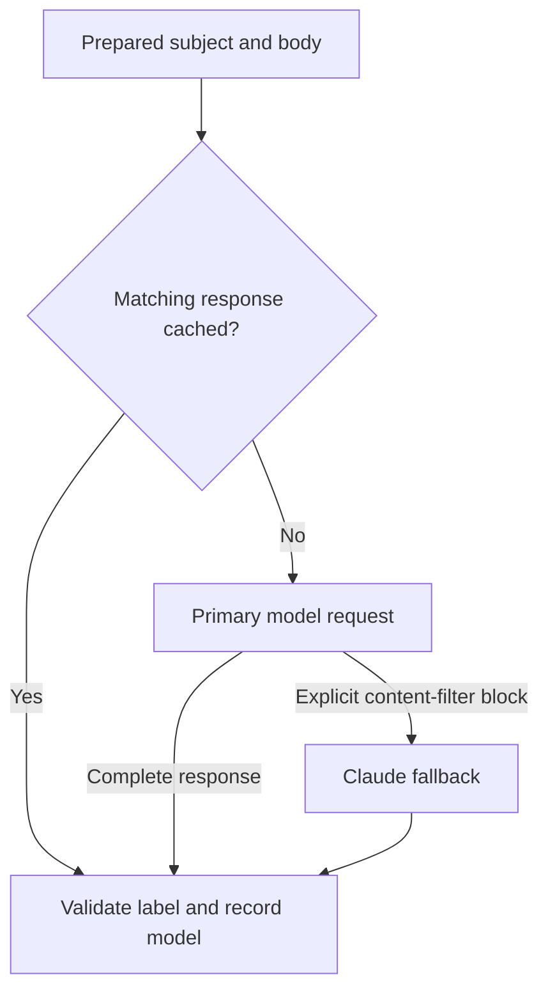

# LLM-based phishing email detection

**Patrick Markey | Security Analyst | Duke University M.Eng. Cybersecurity**

An email-classification project that tests whether prompt changes help an LLM distinguish phishing from non-phishing using only the subject and body. I brought a SOC analyst's perspective to the design: examine observable cues, interpret psychological pressure in context, and identify the requested action.

I evaluated nine prompt configurations on the same 100 validation emails. The strongest configuration achieved **90% validation accuracy** and **0.89964 macro F1**. The submitted pipeline received **0.79166 public macro F1** on 50 hidden-label test emails. The difference matters: performance on a repeatedly inspected validation set did not transfer directly to the public evaluation.

> **Coursework sharing:** Keep this repository private unless course staff permits release. The assignment restricts sharing its code, prompts, analyses, and predictions. Competition data and notebook outputs are excluded from this package.

## What the project demonstrates

- Controlled zero-shot, few-shot, role, output-format, and brief-explanation comparisons.
- A reproducible stratified development/validation split with a fixed seed.
- Strict label parsing, bounded retries, response caching, and explicit failure handling.
- A documented fallback for provider content-filter blocks.
- Error investigation that distinguishes benchmark labels from operational safety judgments.
- Honest reporting of failed prompt revisions and the local/public score gap.

## Results

All local configurations used the same 100 validation emails, with 50 examples of each class. The primary model was the exact Duke Gateway alias `GPT 4.1 Mini`, with temperature 0 and `max_completion_tokens=256`.

| Configuration | Accuracy | Macro F1 | False positives | False negatives |
|---|---:|---:|---:|---:|
| Few-shot V1 | 0.90 | 0.899639 | 8 | 2 |
| Few-shot intent revision | 0.86 | 0.859098 | 11 | 3 |
| Intent + JSON label | 0.84 | 0.836801 | 15 | 1 |
| Intent zero-shot | 0.83 | 0.826087 | 16 | 1 |
| Intent + brief explanation | 0.82 | 0.815271 | 17 | 1 |
| Intent + SOC role | 0.82 | 0.815271 | 17 | 1 |
| Structured V2 | 0.80 | 0.793303 | 19 | 1 |
| Basic | 0.79 | 0.782135 | 20 | 1 |
| Structured V1 | 0.78 | 0.770833 | 21 | 1 |

The best validation confusion matrix was `[[42, 8], [2, 48]]`, using rows for true labels and columns for predictions, ordered `[0, 1]`. Phishing recall was 96%; non-phishing recall was 84%.

These are small-sample experimental results, not evidence of production readiness. Macro F1 is distinct from accuracy.

## Request flow



Other failures use bounded retries or stop the run. They are never silently converted into a legitimate label. Cached fallback responses have separate identities from primary-model responses.

The final test export used **99 primary-model predictions and one `claude-haiku-5-5` fallback**, using the same prepared text, prompt, and demonstrations. The Claude request used temperature 0 and `max_tokens=512`. The local validation metrics describe the primary model; fallback accuracy on blocked labeled inputs was not measured.

## Repository contents

| File | Purpose |
|---|---|
| `llm_phishing_detection.ipynb` | Data preparation, prompts, requests, validation, error review, and export. Outputs are cleared. |
| `docs/case-study.md` | Design decisions, findings, operational failure, and limitations. |
| `data/README.md` | Required private input schemas; no competition data is included. |
| `results/README.md` | Local output descriptions; responses and predictions are excluded. |
| `.env.example` | Empty environment-variable template. |
| `scripts/clear_notebook_outputs.py` | Removes notebook outputs and execution metadata before committing. |

## Run locally

1. Create a Python 3.10+ environment and install dependencies:

   ```bash
   python -m pip install -r requirements.txt
   ```

2. Place the authorized competition files in `data/`, following `data/README.md`. The source assignment data is not redistributed here.
3. Copy `.env.example` to `.env` and supply the private gateway key. Duke Gateway calls require the Duke network or VPN.
4. Open `llm_phishing_detection.ipynb` in VS Code or Jupyter. Run it from this repository's root using the matching Python kernel.
5. Leave `ACTION = "review"` to inspect recorded results without model calls. `validate` evaluates `ACTIVE_VERSION`; `test` regenerates the selected configuration's test CSV. Model calls require credentials, network access, and available quota.

The notebook's recorded summaries are matched to the evaluated prompts, model settings, preprocessing, and data fingerprints. Changed experiments should use a new version name.

## Data handling

The upload package contains no real API key, competition CSVs, raw response logs, prediction CSVs, or saved notebook outputs. `.gitignore` excludes local data, caches, credentials, and generated results. It does not inspect the contents of a notebook, so clear outputs before committing notebook changes:

```bash
python scripts/clear_notebook_outputs.py
```

No client or employer investigation data was used. Task inputs came from the supplied competition files; the SOC experience informed the approach. The original Canvas submission remains separate from this portfolio copy.

## Background and contributions

The [NIST Phish Scale](https://doi.org/10.6028/NIST.TN.2276) and [V-Triad discussion in Heiding et al.](https://doi.org/10.1109/ACCESS.2024.3375882) informed the framing of cues and context. Neither framework was implemented as a numerical classifier.

I supplied the SOC perspective and experiment direction, discussed general triage practices with SOC coworkers, ran the experiments, investigated errors, and completed the scored submission. AI assisted with research, prompt refinement, implementation, troubleshooting, and drafting and refining documentation from the ideas and measured results.

See the [case study](docs/case-study.md) for what helped, what failed, and what I would test next.
